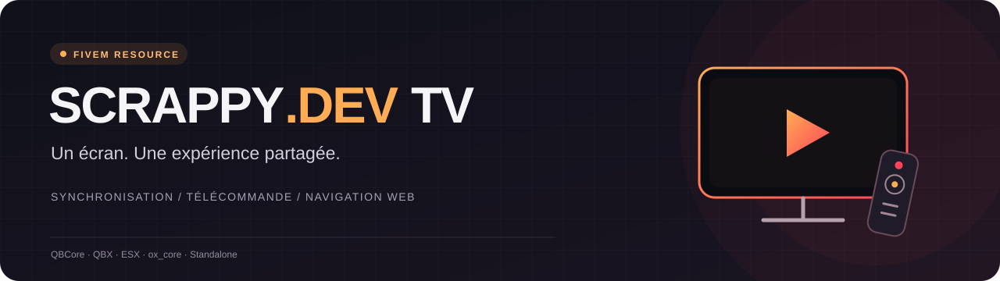

<p align="center">
  
</p>

<p align="center">
  <b>One remote. One screen. A shared experience.</b><br>
  Synchronized video, mouse browsing and custom screens for your FiveM server.
</p>

<p align="center">
  <a href="README.md">Français</a> ·
  <a href="https://scrappyoff.github.io/scrappydev_tv/">Interactive documentation FR / EN</a> ·
  <a href="https://github.com/Scrappyoff/scrappydev_tv/releases/latest">Download</a>
</p>

## Features

- Shared playback state and server clock for supported YouTube and direct media players, including late arrivals.
- NUI remote with channel numbers, guide, apps, color keys, local favorites and history.
- Mouse browsing with one player controlling clicks and scrolling.
- Distance and room attenuation for audio controlled by the resource.
- Supported world TV props, custom MLO screens, presets and in-game calibration.
- Command, optional inventory item and optional `ox_target` access.
- QBCore, QBX, ESX, ox_core and standalone adapters.
- English and French interfaces and documentation.

TV state is stored in server memory. It resets when the resource restarts; configured presets are started again. No resource-specific database is needed.

## Installation

Use a FiveM server with OneSync for server-side player coordinates and routing buckets. **`ox_lib` is required**, including in standalone mode. Frameworks, inventories and `ox_target` are optional integrations.

1. Download **`scrappydev_tv-v1.0.0.zip`** from the [latest release](https://github.com/Scrappyoff/scrappydev_tv/releases/latest).
2. Extract the `scrappydev_tv` folder into your server's resources directory.
3. Start your dependencies before the resource in `server.cfg`:

   ```cfg
   ensure ox_lib
   # Start your framework and inventory here, if used.
   # ensure ox_target   # if Config.Access.target = true
   ensure scrappydev_tv
   ```

4. Edit the existing values in [`config.lua`](config.lua):

   ```lua
   Config.Locale = 'en'
   Config.Framework = 'auto' -- auto, qb, qbx, esx, ox, standalone
   ```

5. Restart the resource, approach a supported TV, type `/tv` and try a public video. Join with a second player to check shared playback on your server.

Alternatively, clone the repository from your resources directory:

```bash
git clone https://github.com/Scrappyoff/scrappydev_tv.git scrappydev_tv
```

> If using GitHub's **Code → Download ZIP**, rename `scrappydev_tv-main` to **`scrappydev_tv`**. Inventory snippets and export examples use this resource name.

## Configuration examples

Replace the corresponding entries in `config.lua`. Example coordinates and `example.com` URLs must be replaced with your own.

### Inventory remote and target

```lua
Config.Access = {
    command = true,
    target = true,       -- requires ox_target
    item = 'tv_remote',
    itemRequired = true,
}
```

Use the matching [ox_inventory](install/ox_items.snippet.txt), [QBCore / QBX](install/qb_items.snippet.txt) or [native ESX](install/esx_items.sql) definition and copy the [remote icon](install/images/tv_remote.png) into your inventory's image directory. The ESX SQL assumes `items(name, label, weight)`; do not import it when using ox_inventory. For access without an item, keep `item = false` and `itemRequired = false`.

### Channels

```lua
Config.Channels = {
    { name = 'Cinema', url = 'https://media.example.com/cinema.mp4' },
    { name = 'Live', url = 'https://media.example.com/live.m3u8' },
}
```

The table order defines channel numbers. The guide is empty by default.

### Custom screens

```lua
Config.Screens = {
    {
        id = 'lobby_screen',
        coords = vec3(0.0, 0.0, 0.0),
        width = 4.0, height = 2.25,
        heading = 0.0, pitch = 0.0,
        maxdistance = 40.0, controldistance = 15.0,
        renderer = 'poly',
    },
}
```

The polygon renderer is included; no third-party `.gfx` is bundled for the optional Scaleform renderer. Use `/tvcalib` near a custom screen, then copy the values printed in F8 into your configuration. Calibration affects the local rendering and does not save the file automatically.

### Permissions

Enable `Config.Permissions` to allow control through the configured ACE **or** an allowed job. If required, the inventory item is still checked separately.

```cfg
add_ace group.admin scrappydev_tv.control allow
```

## Controls

| Command | Action |
| --- | --- |
| `/tv` | Open the nearby TV remote. |
| `/streamermode` | Toggle local mute for players controlled by this resource. |
| `/tvcalib` | Print the active custom screen settings. |
| `/tvcalib width 4.0` | Set the width to 4 meters. |
| `/tvcalib z +0.05` | Move the screen up by 5 centimeters. |

Remote shortcuts: `Escape` closes the active panel or mouse mode; `Tab` toggles the address drawer; arrows and `Enter` navigate; `Page Up` / `Page Down` change channels; `+` / `-` adjust volume; `M` mutes; `P`, `G` and `I` control power, guide and information.

## Media support and limitations

| Source | Behavior |
| --- | --- |
| YouTube | Dedicated player; the video must allow embedding. |
| Direct video and audio | Public file URLs; playback depends on available FiveM browser codecs. |
| HLS `.m3u8` | Native playback or hls.js loaded from `cdn.jsdelivr.net`; the stream must allow the required requests. |
| Images | Public images including PNG, JPEG, WebP and GIF. |
| Vimeo / Dailymotion | Recognized URLs are converted to embedded web player URLs. |
| Twitch and other sites | Web browsing; behavior depends on the site. No dedicated Twitch player is included. |

Playback synchronization, volume control and streamer mute apply to the players managed by this resource. External pages may have their own audio and session state. DRM services are unsupported.

The URL parser rejects literal IP addresses, several local hostname suffixes and configured blocked domains. It does not resolve DNS or inspect every external redirect. Do not include secrets in shared media URLs.

## Developer integration

Client export:

```lua
exports['scrappydev_tv']:OpenTelevision()
```

Server export, using the coordinates of an existing TV or configured screen:

```lua
local coords = vector3(0.0, 0.0, 0.0) -- replace with your TV coordinates
local bucket = 0
local success = exports['scrappydev_tv']:PlayVideoOnTelevision(
    coords, bucket, 50, 'https://media.example.com/cinema.mp4'
)
```

See the [export reference](https://scrappyoff.github.io/scrappydev_tv/#dev-api) for `StartTelevision`, `ChangeVolumeTelevision`, `StopTelevision` and `useRemote`. `HasVehicleTV()` is a compatibility stub returning `false`; vehicle TVs are not implemented.

## Documentation and support

Open the [interactive documentation](https://scrappyoff.github.io/scrappydev_tv/) online, or open `docs/index.html` in a browser after downloading the project. The documentation includes every setting, supported TV props, exports and troubleshooting.

For bugs, [open an issue](https://github.com/Scrappyoff/scrappydev_tv/issues) with the framework, resource version, TV model, reproduction steps and relevant server / F8 errors. Remove private data first. See [CONTRIBUTING.md](CONTRIBUTING.md) for contribution guidance.

Before updating, back up `config.lua` and your locales, install the new files, merge new settings and run `restart scrappydev_tv`. See [CHANGELOG.md](CHANGELOG.md) and [releases](https://github.com/Scrappyoff/scrappydev_tv/releases).

The optional version check is **disabled by default**. To enable it, set `Config.VersionCheck.enabled = true` and `Config.VersionCheck.url = 'https://raw.githubusercontent.com/Scrappyoff/scrappydev_tv/main/version.json'`. It prints update notices without downloading or replacing files.

---

Created by **Scrappy.Dev** · Source published by [Scrappyoff](https://github.com/Scrappyoff).

This repository contains readable source code. No open-source license is declared for this release.
